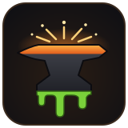
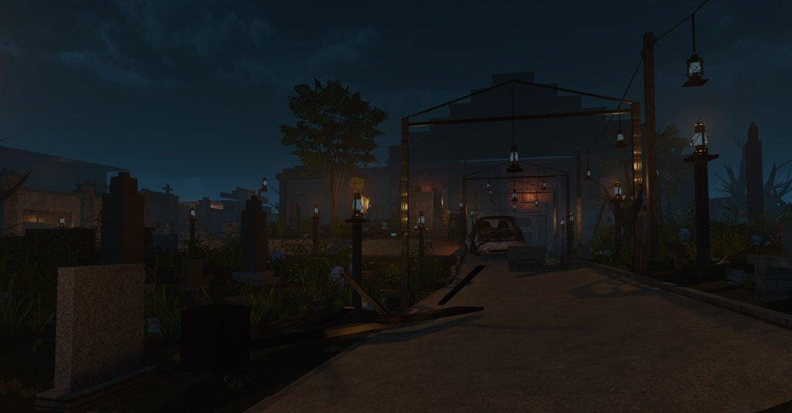
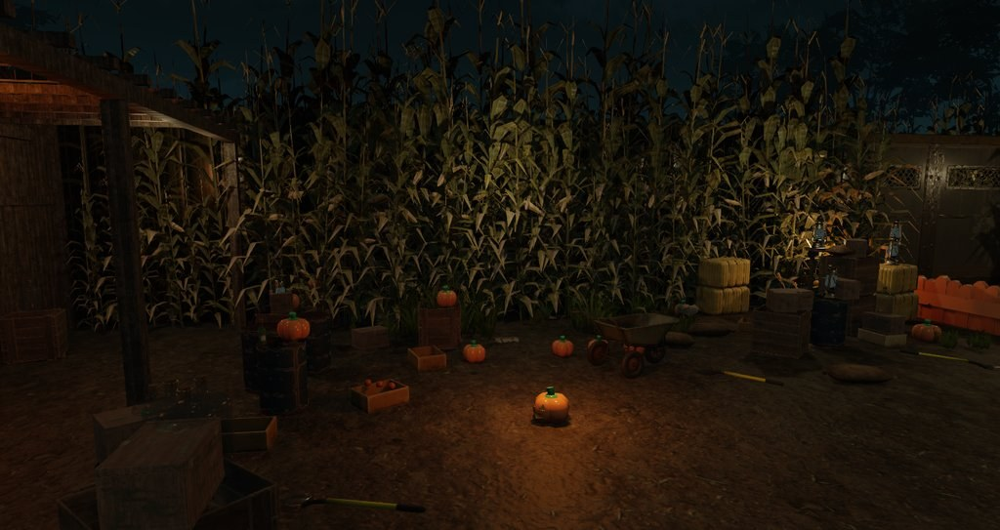
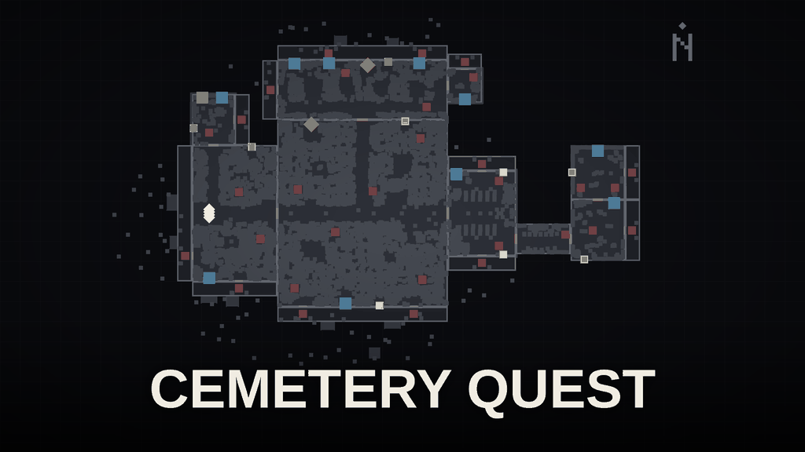
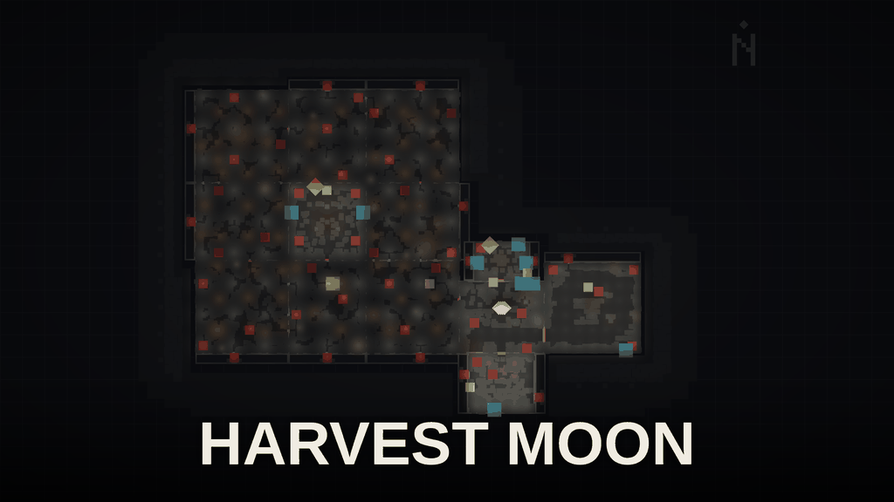

<div align="center">
    
    <h1>zmforge</h1>
    <h3><em>Black Ops III zombies maps, written in Python and built with Claude.</em></h3>
</div>

<p align="center">
    <a href="LICENSE"></a>
    
    <a href="https://claude.com/claude-code"></a>
    
</p>

<p align="center">
    <a href="#quick-start">Quick start</a> ·
    <a href="#make-your-own-map-with-claude">Make a map with Claude</a> ·
    <a href="docs/README.md">Docs</a> ·
    <a href="#licence">Licence</a>
</p>

zmforge is Python tooling for making Call of Duty: Black Ops III custom
zombies maps, built so that an AI coding agent like
[Claude Code](https://claude.com/claude-code) can make them with you. A map
is a short Python file (rooms, doors, perks, a quest, a boss). zmforge turns
it into the files the official mod tools need, and checks it for mistakes
that would break the map in game.

Because the whole map is code, you can describe the map you want in plain
English and let Claude write it. Every check names what is broken and why,
and zmforge can take pictures of each room, so Claude can see and fix its
own mistakes. Both maps below were made this way.

| Cemetery Quest (`cemetery`) | Harvest Moon (`corn_maze`) |
| :---: | :---: |
|  |  |

<details><summary>Map plans</summary>

| Cemetery Quest | Harvest Moon |
| :---: | :---: |
|  |  |

</details>

## Quick start

You need Black Ops III and the Black Ops III Mod Tools (Steam, Windows),
and Python 3.11 or newer. The mod tools are their own Steam app (455130)
and install to their own folder beside the game's, with `455130` at the end
of its name. `--tools-root` points there.

In PowerShell:

```powershell
git clone <repository URL> zmforge; cd zmforge
py -m venv .venv
.venv\Scripts\pip install -e ".[dev]"

$TOOLS = "C:\Program Files (x86)\Steam\steamapps\common\Call of Duty Black Ops III 455130"
.venv\Scripts\zmforge generate zm_my_first_map --recipe three-room --tools-root "$TOOLS"
```

<details><summary>Linux or macOS shell</summary>

```sh
python3 -m venv .venv && .venv/bin/pip install -e '.[dev]'
TOOLS="/path/to/steamapps/common/Call of Duty Black Ops III 455130"
.venv/bin/zmforge generate zm_my_first_map --recipe three-room --tools-root "$TOOLS"
```

</details>

Then open the Mod Tools Launcher, pick `zm_my_first_map` and tick Compile,
Light and Link. The linker writes `usermaps/zm_my_first_map` inside the mod
tools folder; the game reads `usermaps` inside its own folder
(`Call of Duty Black Ops III`), so copy or junction it across
(`docs/public/wiring-your-build.md`, "Build, render and install").

Built-in recipes: `one-room` and `three-room` (small starters), `dmv`,
Cemetery Quest (`cemetery`, plus the `cemetery-dusk` variant) and Harvest
Moon (`corn_maze`). `zmforge generate --help` lists them.

### Make your own map with Claude

Open [Claude Code](https://claude.com/claude-code) in the zmforge folder and
describe the map you want. `CLAUDE.md` tells it how to work in this
repository.

```text
Make a new zmforge map called haunted_school: a small school at night,
spawn in the gym, three rooms to open up, Juggernog and Speed Cola, a
Pack-a-Punch behind a three-step quest, and lots of props. My mod tools
are at <tools path>. Keep going until the checks pass.
```

Then build it with the mod tools and playtest. Tell Claude what felt wrong
and it will change the map. Taking pictures of rooms needs the optional
Linux setup (see "More").

<details><summary>More</summary>

- **Checks:** about 140 checks run before anything is written (spawns,
  reachable floor, blocked rooms and more); `zmforge check` re-checks the
  written files.
- **Tests:** `.venv\Scripts\pytest -q` (`.venv/bin/pytest -q` on Linux);
  tests that need the game skip themselves.
- **Linux:** `generate` runs anywhere. An optional Wine setup
  (`zmforge build` and `zmforge render`) patches one import in your own copy of the tools'
  Embree library (Apache-2.0); Steam's terms restrict modifying Steam
  software, so it's your call. See `docs/public/wiring-your-build.md` and
  `docker/bo3-wine/PATCHES.md`.
- **Docs:** `docs/README.md` covers how zombies maps work, the generator
  and file formats, and how an AI agent can build and review maps.

</details>

## Licence

PolyForm Noncommercial 1.0.0 (`LICENSE`); third-party parts are listed in
`THIRD_PARTY.md`. Maps you build fall under the mod tools' terms and may only
be shared free of charge.

Credits: [`ACKNOWLEDGEMENTS.md`](ACKNOWLEDGEMENTS.md).

zmforge is an independent project, not affiliated with or endorsed by
Activision, Treyarch or Valve. Call of Duty and Black Ops III are trademarks
of Activision Publishing, Inc.
